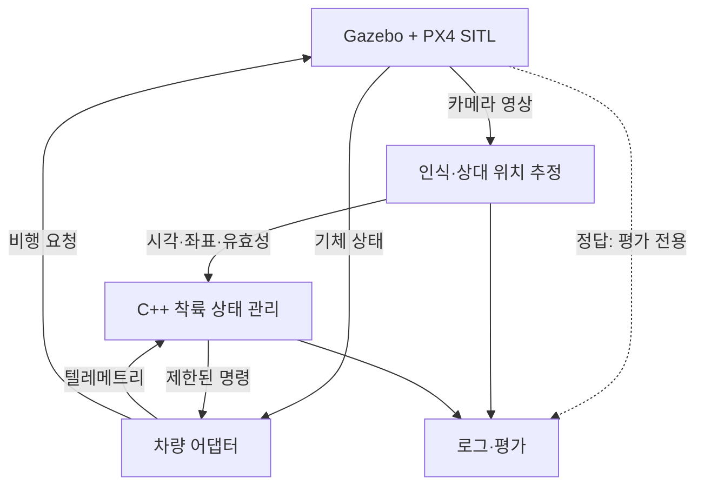

# UAV Precision Landing

Vision-guided UAV landing with a C++ companion application, PX4 simulation, and reproducible perception and latency evaluation.

카메라로 지정 착륙 패드를 관측하고 상대 위치를 추정해 접근·정렬·하강을 판단하는 프로젝트입니다. 관측이 오래되거나 인식이 끊기면 하강을 보류·중단하도록 설계하고, 인식 품질과 처리 지연이 착륙 결과에 미치는 영향을 비교합니다.

> **상태: M1 최소 판단 데모 — 2026-11-19.** 클라우드 Linux x86_64에서 C++20 빌드·실행과 12개 테스트를 확인했습니다. 합성 관측·시계·임무 활성 플래그로 정렬/하강 의도·보류를 판단하며 화면에만 출력합니다. 카메라·PX4·Gazebo·실제 장비는 아직 연결하지 않았습니다. [실행 결과와 한계](docs/cloud-m1.md).

## 목표와 범위

- 단일 멀티콥터, 정지한 지정 패드, 하방 카메라를 사용하는 시뮬레이션을 기본으로 합니다.
- Linux/Modern C++로 관측의 유효성·시간·소유권, 착륙 상태 전이와 차량 인터페이스를 직접 구현합니다.
- 고전적 marker/기하 관측으로 기준 동작을 만든 뒤, 학습 기반 인식 하나와 실제 병목 최적화를 비교합니다.
- PX4의 기존 자세·비행제어를 사용합니다. 본 프로젝트의 책임은 companion 측 관측·유도 판단·실패 대응입니다.
- 처음부터 실기체·Pixhawk·Jetson을 요구하지 않습니다. 이동 패드·복수 기체·SLAM·새 비행제어기·범용 AI 런타임은 초기 범위 밖입니다.

## 구성안



비전 관측과 차량 명령은 구분합니다. Gazebo의 정답 패드 위치는 평가기에만 전달하고 최종 착륙 판단의 입력으로 사용하지 않습니다. 초기에 가짜 관측을 넣는 단계는 상태 전이 시험으로만 표시합니다.

| 모듈 | 직접 다룰 책임 |
|---|---|
| 인식·상대 위치 | 영상 수신, marker/학습 인식, 카메라 기하, 좌표 변환, 관측 품질 |
| 착륙 상태 관리 | 접근·정렬·하강 허용 조건, 관측 만료, 보류·중단, 명령 제한 |
| 차량 어댑터 | 가짜 차량/PX4 연결, 텔레메트리, 명령 전송, 모드·연결 상태 확인 |
| 기록·평가 | 관측/판단/명령 대응, 실패 주입, 착륙 결과·처리시간 비교 |

처음부터 모듈마다 별도 프로세스를 만들지 않습니다. 작은 C++ 실행 파일에서 시작하고, 영상 처리 부하를 확인한 뒤 필요한 worker만 분리합니다. 상태 전이는 한 실행 경로가 소유하고 worker는 관측을 전달합니다.

## 기술 선택안

| 영역 | 시작안 | 확정 시점 |
|---|---|---|
| 실행 환경 | Linux, C++20, CMake | 첫 확인: Debian 13 x86_64, GCC 14.2.0, CMake 4.4.5; ARM/실장비 미검증 |
| 시뮬레이션 | PX4 SITL + Gazebo | 실제 PC의 실행 가능성과 카메라 모델 확인 후 버전 고정 |
| 차량 연결 | MAVSDK C++ Offboard를 우선 검토 | 필요한 명령·모드 전환·실패 동작을 SITL에서 확인 |
| 기준 인식 | OpenCV 기반 marker 검출과 기하 추정 | 패드·카메라 사양을 정할 때 선택 |
| 학습·평가 | Python/PyTorch, 로그 분석 | 기준 동작과 분리된 학습/평가 장면 확보 후 |
| 추론 최적화 | profiler로 병목을 확인한 뒤 실행 경로 개선 | GPU 접근·배포 환경 확인 후 TensorRT/CUDA 필요성 판단 |

영상은 Gazebo의 카메라 인터페이스로 받고 비행 명령은 차량 어댑터가 담당하도록 설계합니다. MAVSDK가 카메라 프레임까지 전달한다고 가정하지 않습니다. Gazebo 영상 topic/stream, 하방 카메라 장착 방향과 시간 정보는 환경 검증에서 확정합니다. ROS 2는 연결 요구가 생기면 검토합니다.

## 먼저 정할 데이터 계약

| 데이터 | 최소 내용 |
|---|---|
| 관측 | frame ID, 획득/수신 시각, clock domain, 좌표계, 단위, 상대 위치, 품질·유효성 |
| 기체 상태 | 자세·고도/위치·속도 중 필요한 값, 시각, 비행 모드, 연결·추정 상태 |
| 판단/명령 | 근거 관측 ID, 생성/만료 시각, 명령 종류·좌표계·단위·상한 |
| 실행 기록 | 상태 전이 이유, 처리 구간 시각, 폐기 이유, 명령/모드 확인 결과 |

카메라·기체·월드 좌표를 구분하고 변환 책임을 한곳에 둡니다. 카메라 optical frame과 PX4 NED/body frame의 축·부호를 문서화합니다. 동기화되지 않은 시각을 단순히 빼서 지연으로 표시하지 않습니다.

## 단계별 구현

| 단계 | 작업 | 완료 증거 |
|---|---|---|
| M0 — 완료 | README에 목표·책임·범위·단계 정리 | 설계 초안 |
| M1 — 최소 경로 실행 | 합성 관측·시계·임무 활성 플래그로 정렬/하강 의도·보류 판단 | 데모와 12개 테스트 통과. 차량 상태·수치 명령·전체 착륙 상태는 후속 |
| M2 — 실제 영상 | Gazebo 하방 영상, marker 검출, 상대 위치·좌표 변환 | 영상 기반 추정과 평가용 정답의 오차 로그 |
| M3 — SITL 연결 | 제한된 접근·정렬·하강 판단과 차량 어댑터 연결 | 정지 패드 착륙과 관측 소실 시 하강 보류·중단 재현 |
| M4 — 실행 신뢰성 | 큐 상한, 지연/만료, worker 중단·재시작, 모드/연결 손실 대응 | 가림·지연·worker 중단에서 예상한 상태·명령·복귀 기록 |
| M5 — AI·성능 비교 | 학습 인식 하나, 추론 profiling, 병목 개선 | 같은 조건의 인식 품질·전체 지연·착륙 결과 비교 |

M3에서는 최소한의 관측 만료·명령 제한·실패 대응을 함께 구현합니다. M4는 그 동작을 부하와 프로세스 경계까지 확장하는 단계입니다.

첫 코딩 작업으로 가짜 관측의 ID·시각·유효성을 읽고 상태와 명령 의도를 출력하는 `landing_demo`를 구현했습니다. 정상 관측 → 만료된 관측 → 관측 소실 → 유효 관측 복귀와 재전송·비활성화를 실행합니다. 실제 비행 요청은 M3에서 연결합니다. 이 초안은 AI 코딩 보조로 작성했으며, 사용자 직접 구현 숙련이나 전체 P2 완료를 의미하지 않습니다.

### 착륙 판단과 실패 대응

- 기본 상태 후보: 대기, 탐색, 접근, 정렬, 하강, 보류, 착륙 확인, 중단.
- 오래된 관측이나 품질 기준 미달 관측으로 새로운 하강 명령을 만들지 않습니다.
- 보류 시 명령, 중단 후 모드 전환, 복귀 조건은 단계·고도·기체 상태를 고려해 정하고 SITL에서 검증합니다.
- worker 재시작 전의 늦은 결과는 epoch/ID·만료 규칙으로 구분합니다.
- MAVSDK Offboard의 setpoint 재전송이 계속되는 것과 새로운 비전 관측이 들어오는 것은 별개입니다. 마지막 하강 명령이 계속 재전송되지 않도록 관측/판단 만료와 대체 명령을 별도로 관리합니다.
- SDK 호출 성공만으로 기체의 실행을 단정하지 않고 모드·텔레메트리·연결 상태를 확인합니다.

## 디렉터리 계획

현재 `apps/`, `include/landing/`, `src/`, `tests/`, `docs/`를 사용합니다. 아래 나머지 위치는 실제 구현이 필요해질 때 만듭니다.

| 위치 | 용도 |
|---|---|
| `apps/` | 데모·SITL 실행 진입점 |
| `include/landing/`, `src/` | 데이터 계약과 핵심 C++ 모듈 |
| `tests/` | 상태 전이·시간/좌표 경계·실패 대응 검증 |
| `sim/` | 패드·하방 카메라·시나리오 설정 |
| `tools/` | 데이터 생성·학습·로그 평가 |
| `configs/` | 부하·제한·임계값 설정 |
| `docs/` | 구조·좌표/시간 계약·설계 결정·검증 기록 |

비어 있는 폴더나 미구현 클래스의 수를 늘리는 것을 초기 진척으로 계산하지 않습니다.

## 평가와 P2 완료 기준

고전 관측과 학습 관측을 같은 패드·초기 상태·조명/가림·지연 조건에서 비교합니다. 제어 조건은 고정하고 관측 backend와 실행 정책을 한 번에 하나씩 바꿉니다. 학습/평가는 프레임 임의 분할 대신 장면·episode 단위로 분리합니다.

- 관측: 검출/상대 위치 오차, 유효 관측 비율, 관측 나이.
- 실행: 모델 지연과 입력부터 판단/명령까지의 지연, p50/p95/p99, 큐 폐기·CPU/메모리.
- 착륙: 착지 오차, 성공 수/전체 수, 중단·시간 초과·패드 밖 착지. 중단을 성공 착륙에 합산하지 않습니다.
- 재현: commit·버전·설정·seed·원시 로그·시나리오와 2~3분 시연.

허용 착지 오차·속도·시간과 지연 예산은 기준 동작을 확인한 뒤 평가 실행 전에 고정합니다. 가상 지연 주입과 실제 wall-clock 실행을 구분하고, 인식이 느리다고 시뮬레이터를 멈춰 지연 영향을 숨기지 않습니다.

P2의 대표작 완료에는 영상 기반 폐루프 착륙, 가림·지연·추론 중단 대응, 학습 인식과 기준 방식 비교, 직접 개선한 병목의 정량 결과가 필요합니다. M1의 가짜 입력 데모나 예제 실행만으로 완료 표시하지 않습니다. GPU 최적화 결과는 해당 장비에서 실제 측정한 경우에만 별도로 표시합니다.

## 실행 방법

C++20 컴파일러, CMake 3.20 이상과 Ninja가 있는 환경에서 저장소 루트를 기준으로 실행합니다. 현재 데모에는 OpenCV·PX4·ROS 2 등 외부 라이브러리가 필요하지 않습니다.

```sh
cmake -S . -B build -G Ninja -DCMAKE_BUILD_TYPE=Release
cmake --build build
ctest --test-dir build --output-on-failure
./build/landing_demo
```

데모는 합성 시간의 입력 11개를 즉시 처리해 CSV 형식으로 출력합니다. 실제 시간에 맞춘 비행 시뮬레이션이나 성능 측정이 아닙니다. [입력 계약·기준·검증 환경·sanitizer 실행법](docs/cloud-m1.md).

로컬 개발용 `release`, `debug`, `sanitize` CMake preset과 VS Code 설정도 제공합니다. [macOS 설정·실행 방법과 검증 결과](docs/local-setup.md).

## 참고 자료

공식 문서 확인: 2026-11-16. `main` 문서는 변할 수 있으므로 구현 시 선택한 release/commit과 호환 조합을 기록합니다.

- [PX4 Simulation — SITL과 HITL](https://docs.px4.io/main/en/simulation/)
- [PX4 Gazebo Simulation — 모델·카메라·실행 환경](https://docs.px4.io/main/en/sim_gazebo_gz/)
- [MAVSDK C++ Offboard — 명령·재전송·모드 확인](https://mavsdk.mavlink.io/main/en/cpp/guide/offboard.html)

